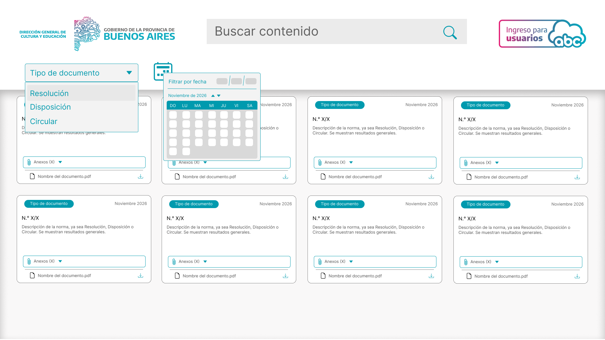

# Documento de Especificación de Requerimientos (SRS)

**Proyecto:** Portal web dinámico de normativas, resoluciones y planes de estudio de nivel secundario técnico (DGCyE - GBA)
**Materia:** Proyecto de Implementación de Sitios web Dinámicos
**Escuela:** EEST N.º 1 "Eduardo Ader", Vicente López
**Curso:** 7.º año, 2.º Grupo B
**Actividad:** 18 - Levantamiento de requerimientos y entrevista con el cliente
**Alumno:** Mateo Silvero
---

## 1. Minuta de entrevista

**Cliente:** Dirección General de Cultura y Educación de la Provincia de Buenos Aires (DGCyE)
**Participantes:** directores de área del Ministerio de Educación y el equipo de desarrollo
**Tema:** necesidades para un portal de consulta de normativas del nivel secundario técnico

**Resumen (5 líneas):**

1. Inspectores, directores de escuelas técnicas de GBA y docentes pierden mucho tiempo buscando resoluciones, circulares y planes de estudio en PDFs desordenados.
2. Necesitan un buscador dinámico por palabras clave cuyos resultados aparezcan al instante, sin recargar la página.
3. Piden un calendario histórico y filtros por año, mes y tipo de norma (Resolución, Disposición, Circular).
4. Requieren un panel de visualización rápida de anexos, como los Excel de planes de estudio y los PDF de normativas, con descarga directa.
5. El sistema debe funcionar con fluidez tanto en computadoras del Estado como en celulares de los docentes.

> **Nota de entrega:** esta minuta debe presentarse además en formato **APA 7.ª edición, en PDF**. El texto de arriba sirve como base para ese archivo.

---

## 2. Requerimientos

### 2.1 Requerimientos funcionales (lo que el sistema DEBE hacer)

| ID | Requerimiento | Descripción |
|----|---------------|-------------|
| RF-01 | Búsqueda dinámica en tiempo real | El usuario ingresa términos en una barra de búsqueda y el listado de normativas se filtra al instante, sin recargar la página. |
| RF-02 | Filtro por año y mes | El usuario puede seleccionar resoluciones por año y mes mediante un calendario interactivo. |
| RF-03 | Filtro por tipo de norma | El usuario puede filtrar por tipo: Resolución, Disposición o Circular. |
| RF-04 | Combinación de filtros | La búsqueda por texto, el calendario y el tipo de norma pueden aplicarse a la vez. |
| RF-05 | Visor de anexos y enlaces | Cada normativa muestra su listado de documentos asociados (PDF de resoluciones, grillas de planes de estudio en formato tabular). |
| RF-06 | Descarga directa | Cada anexo puede descargarse directamente desde el visor. |
| RF-07 | Lectura de planillas | Los archivos de planes de estudio en `.xlsx` o `.csv` se pueden previsualizar en el navegador (por ejemplo con SheetJS). |

### 2.2 Requerimientos no funcionales (cómo debe comportarse el sistema)

| ID | Requerimiento | Descripción |
|----|---------------|-------------|
| RNF-01 | Rendimiento | El filtrado se ejecuta del lado del cliente, en memoria con JavaScript, en menos de 100 ms para garantizar 60 fps. |
| RNF-02 | Compatibilidad y responsividad | La interfaz se adapta a smartphones de docentes y a escritorios institucionales (pantallas 1080p). |
| RNF-03 | Despliegue y CI/CD | Despliegue automático en la nube (Vercel, Render o similar) mediante integración continua conectada a GitHub. |
| RNF-04 | Seguridad | El sitio se sirve por HTTPS y no expone datos sensibles en el código del cliente. |
| RNF-05 | Usabilidad | Un usuario sin capacitación previa debe poder encontrar una normativa en pocos pasos desde la pantalla principal. |

> RF-04, RF-07, RNF-04 y RNF-05 son requerimientos propuestos por el equipo a partir de lo conversado en la entrevista. Conviene confirmarlos con el cliente.

---

## 3. Modelo de datos inicial

Estructura JSON simulada para las pruebas iniciales. Se extiende el ejemplo de la consigna con el campo `anexos`, necesario para RF-05 y RF-06.

```javascript
const normativasDGCyE = [
  {
    id: 1,
    nro: "651/26",
    tipo: "Resolución",
    anio: 2026,
    mes: "Octubre",
    desc: "Aprueba pliegos y autoriza llamada a Licitación Pública para talleres de EEST.",
    anexos: [
      { nombre: "Resolución 651-26.pdf", formato: "pdf", url: "/anexos/res-651-26.pdf" }
    ]
  },
  {
    id: 2,
    nro: "420/25",
    tipo: "Disposición",
    anio: 2025,
    mes: "Marzo",
    desc: "Actualización de planes de estudio ciclo superior 7mo año Técnico en Programación.",
    anexos: [
      { nombre: "Disposición 420-25.pdf", formato: "pdf", url: "/anexos/disp-420-25.pdf" },
      { nombre: "Plan de estudio 7mo año.xlsx", formato: "xlsx", url: "/anexos/plan-7mo-programacion.xlsx" }
    ]
  },
  {
    id: 3,
    nro: "128/26",
    tipo: "Circular",
    anio: 2026,
    mes: "Mayo",
    desc: "Pautas organizativas para ferias de ciencia distritales y regionales ACTE GBA.",
    anexos: [
      { nombre: "Circular 128-26.pdf", formato: "pdf", url: "/anexos/circ-128-26.pdf" }
    ]
  }
];

// Búsqueda por texto y filtros combinados
function filtrarNormativas(lista, { texto = "", anio = null, mes = null, tipo = null }) {
  const t = texto.trim().toLowerCase();
  return lista.filter(n =>
    (!t || n.desc.toLowerCase().includes(t) || n.nro.includes(t)) &&
    (!anio || n.anio === anio) &&
    (!mes || n.mes === mes) &&
    (!tipo || n.tipo === tipo)
  );
}
```

---

## 4. Mockup o boceto inicial



_Figura 1: Boceto de la interfaz del portal de normativas con barra de búsqueda, selector de tipo de documento, filtro por calendario/fecha y tarjetas con visor/descarga de anexos._

**Elementos que debería mostrar el boceto, según los requerimientos:**

- Barra de búsqueda destacada en la parte superior (RF-01).
- Calendario interactivo y selector de tipo de norma como filtros (RF-02, RF-03).
- Listado de resultados con número, tipo, fecha y descripción de cada norma.
- Panel o visor de anexos con botón de descarga (RF-05, RF-06).
- Versión móvil y versión escritorio (RNF-02).
